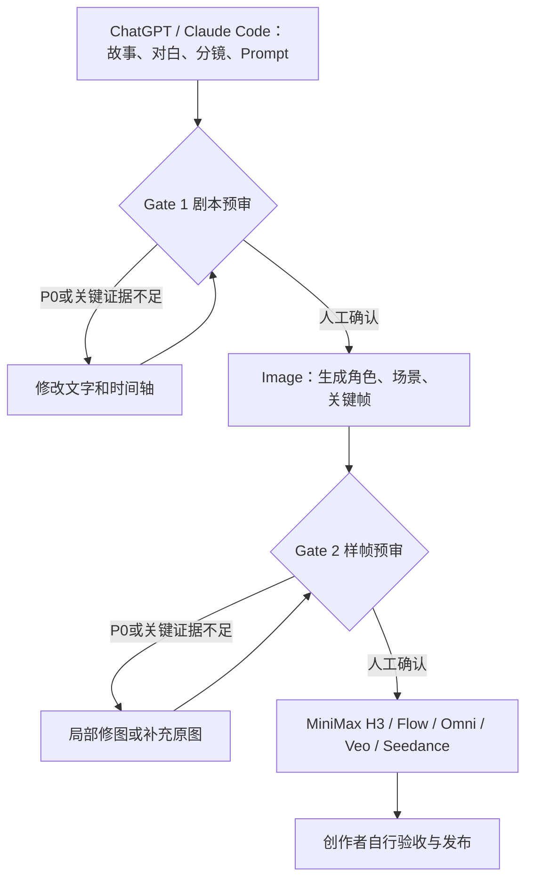

# VideoGate · 两道 AI 视频生成前质检关

**别急着点生成，先把错误挑出来。** VideoGate 是 ModengSir 的多 Agent、模型无关开源预审 Skill。

> **范围**：Gate 1 审剧本/分镜/Prompt，Gate 2 审人物/场景/关键样帧。**不生成视频、不做成片质检**，也不保证一次成功或宣称节省了未经测量的费用。



## 立即使用

**零安装**：将 [`prompts/universal-reviewer.md`](prompts/universal-reviewer.md) 设置为审核智能体的系统指令，然后按需追加 [`prompts/gate1.md`](prompts/gate1.md) 或 [`prompts/gate2.md`](prompts/gate2.md)，输入真实材料。文本模型能执行 Gate 1，只有实际获得图像输入的多模态模型才能执行 Gate 2 的视觉判断。Ling 不是必需依赖。

**安装到 Agent**（Python 3.9+，不依赖第三方包）：

```bash
git clone https://github.com/modengsir/VideoGate.git
cd VideoGate
python3 scripts/install.py --agent codex --scope user
# claude-code / cursor / gemini-cli / opencode / copilot / kiro
```

Windows：`py -3 scripts/install.py --agent claude-code --scope user`；指定现有项目：`python3 scripts/install.py --agent cursor --scope project --target /path/to/project`。使用 `--dry-run` 预览，`--uninstall` 卸载，`--force` 备份后覆盖。详细目录、限制、调用方法见 [Agent 安装表](docs/agents.md)。

**最快的两关测试**：

1. 提交 [`templates/project-brief.md`](templates/project-brief.md) 和分镜表，要求“VideoGate Gate 1，按八项规则报告，不改写剧本”。
2. 修复 P0 并复审。准备身份锚点和编号图片（例如 `@Image1`、`@Image2`），执行 Gate 2。
3. 用审核报告逐项修图并复审；创作者决定何时将素材交给视频模型。

所有审核必须输出 `PASS` / `FAIL` / `UNVERIFIED`、P0 / P1 / P2、具体证据、最小修复方案，提供 Markdown 报告，自动化时可输出符合 [JSON Schema](schemas/review-result.schema.json) 的机器结果。**待验证不是通过**。

## 项目资源

- [Skill 入口](.agents/skills/video-gate/SKILL.md) · [统一审核规则](.agents/skills/video-gate/references/review-policy.md)
- [Gate 1 项](.agents/skills/video-gate/references/gate1.md) · [Gate 2 项](.agents/skills/video-gate/references/gate2.md)
- [使用流程](docs/workflow.md) · [自建智能体](docs/custom-agent.md) · [单图拼版](prompts/single-image.md)
- [模型与平台说明](docs/models.md) · [隐私与安全](docs/privacy.md) · [疑难排查](docs/troubleshooting.md)
- [真实案例](examples/childhood-self/README.md) · [报告模板](templates/review-report.md) · [成本模板](templates/cost-log.csv)
- [测试和贡献](CONTRIBUTING.md) · [English README](README_EN.md)

**兼容目标**：Claude Code、Codex、Cursor、Gemini CLI、OpenCode、GitHub Copilot、Kiro。各 Agent 的版本、加载行为和文件/视觉能力可能不同；兼容不等于经过所有版本的实机验证。

作者：[ModengSir](https://github.com/modengsir) · MIT License · v0.1.0
